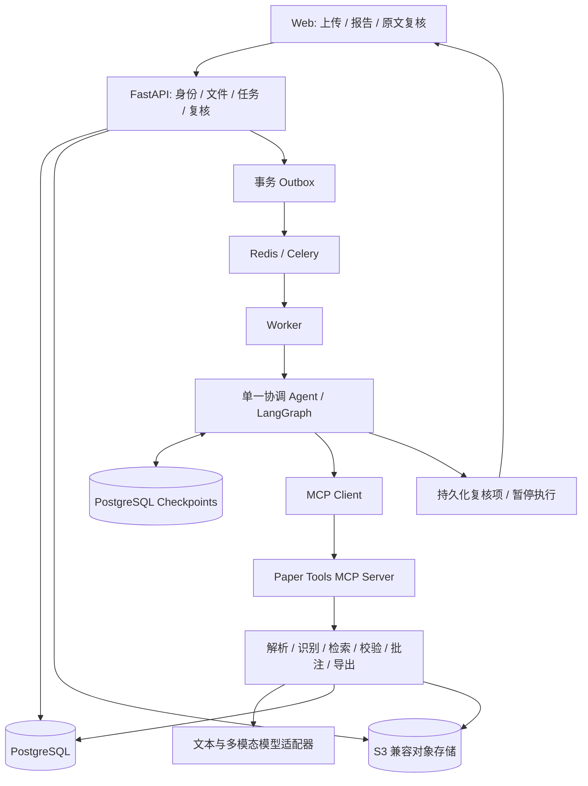
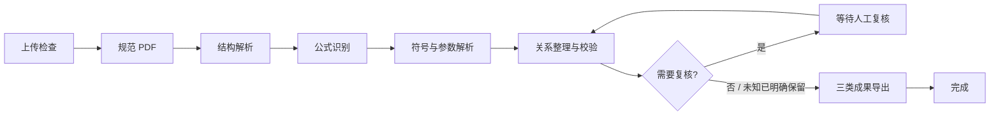

# Paper2Formula

论文公式与参数解析 Agent：上传 PDF 或 DOCX，生成可追溯的公式说明报告、带批注的 PDF 副本和结构化 JSON。

**当前阶段：架构设计。** 本仓库包含设计文档、接口约定和输出示例，尚未实现 Web 服务、模型调用或论文解析。示例是人工编写的演示数据，不代表模型识别结果。

## 产品目标

- 解释公式、符号、参数数值和单位，每条事实关联原文证据。
- 报告条目点击后定位到 PDF 对应页与批注区域。
- 缺失定义、识别歧义和单位冲突进入人工复核，保留“待核对”状态。
- 保留原文件，生成独立批注副本；用户修改可审计、可重新校验。

## 系统架构



协调 Agent 按固定状态图调用工具，仅在证据范围内完成语义解释。队列负责调度，状态图负责处理进度与恢复，数据库保存领域数据，对象存储保存大文件。详见 [架构设计](docs/architecture.md)。

## 主流程

1. 上传与检查：识别真实文件类型、检查大小/页数/加密状态；扫描件在首版明确返回不支持。
2. 规范化：PDF 直接使用；DOCX 经隔离转换器生成规范 PDF，记录转换版本与哈希。
3. 结构解析：从规范 PDF 提取章节、段落、表格、公式候选和位置锚点。
4. 公式识别：生成稳定 EQ 编号、LaTeX、原公式编号与证据截图。
5. 参数解析：检索附近段落、符号表及相关章节，按公式与章节作用域绑定符号定义、值和单位。
6. 关系与校验：整理明确引用，检查语法、证据完整性、符号缺失和可判定的量纲冲突。
7. 复核分流：存在歧义或校验问题时暂停，用户确认、修订或保留未知后重新校验。
8. 统一导出：同一结果版本生成 Markdown、JSON 和批注 PDF，全部成功后发布下载链接。



详细的输入输出、暂停恢复与失败处理见 [工作流设计](docs/workflow.md)。

## 首版范围

支持文本型 PDF、DOCX、编号公式、就近变量定义、参数值及单位。优先实现“报告—原文—复核”的闭环。扫描 OCR、复杂跨页公式、多篇论文比较和语义向量检索进入后续阶段。Word 输出为转换后的批注 PDF；不承诺原生 Word 批注或原 Word 页码一致。

## 技术选型（计划）

| 模块 | 选择 | 职责 |
|---|---|---|
| Web | Next.js / TypeScript / PDF.js | 上传、进度、报告及证据定位 |
| API | Python / FastAPI | 授权、业务接口、复核事务 |
| 工作流 | LangGraph + PostgreSQL Checkpointer | 固定节点、人工中断与恢复 |
| 调度 | Celery / Redis + 事务 Outbox | 异步触发、重试与补偿 |
| 工具协议 | Python MCP SDK | 本地 stdio；部署时受保护的 HTTP |
| 解析 | Docling 适配器 | 版面、章节、表格与公式候选 |
| DOCX 转换 | 隔离 LibreOffice Worker | 生成规范 PDF |
| 公式 | 可替换识别模型 / SymPy | LaTeX 识别与有限数学校验 |
| 批注 | PyMuPDF | 框选、下划线、高亮、文本注释 |
| 数据 | PostgreSQL / S3 兼容存储 | 结构化证据、版本与产物 |
| 观测 | OpenTelemetry；可选 Langfuse | 调用耗时、失败、模型用量 |

实现阶段根据兼容性验证锁定依赖版本，不直接使用未经测试的浮动最新版。官方资料与实现注意事项见 [架构参考](docs/architecture.md#官方参考与兼容性)。

## 仓库导航

```text
README.md                 项目入口与主流程
docs/architecture.md      组件、数据模型、证据定位与部署
docs/workflow.md          状态图、恢复机制与复核规则
docs/interfaces.md        REST / MCP 契约与错误约定
docs/roadmap.md           开发顺序与验收标准
examples/result.json      可追溯结果示例
examples/report.md        对应 Markdown 报告示例
scripts/check_docs.py     链接与示例一致性检查
.gitignore                排除凭据、论文与运行产物
```

计划中的实现目录为 `apps/web`、`apps/api`、`workers`、`packages/domain`、`packages/workflow`、`packages/paper_tools`、`packages/providers`、`infra` 和 `tests`；本阶段不创建空服务或伪造启动命令。

## 当前可执行操作

安装 Python 3.11 或更高版本后，在仓库根目录运行文档与示例检查，无需第三方依赖：

```powershell
python scripts/check_docs.py
```

服务启动说明将在实现相应服务后补充。开发计划与可验收的里程碑见 [路线图](docs/roadmap.md)。

## 数据与贡献

请勿提交真实用户论文、访问令牌、`.env` 或模型请求中的敏感内容。评测材料仅使用有权使用的论文，并记录标注协议与授权范围。尚未选定开源许可证；公开发布前由项目所有者确定。
