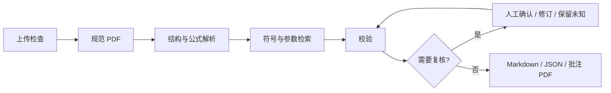

# Paper2Formula

论文公式与参数解析 Agent：上传 PDF 或 DOCX，查看公式、符号和参数的原文证据，处理人工复核，下载同一结果版本的 Markdown 报告、结构化 JSON 和批注 PDF。

**当前阶段：第一版实现。** 前端采用 React + TypeScript + Vite，后端采用 FastAPI。使用 Conda 管理 Python 与 Node.js，配置统一放在仓库根目录 `.env`。默认通过 SQLite、本地文件与后台任务运行，无需先启动数据库容器；也提供 PostgreSQL、Redis/Celery 与 S3 兼容存储的接入配置。

## 快速启动

安装 Conda 后，在仓库根目录执行：

```powershell
# 创建/更新 Conda 环境并安装 Python、前端依赖；保留已有 .env。
.\scripts\setup.ps1

# 后台启动 API 与 Web，日志写入 data/runtime。
.\scripts\dev.ps1
```

打开 `http://localhost:5173`，API 文档为 `http://127.0.0.1:8000/docs`。停止服务：

```powershell
.\scripts\stop.ps1
```

Conda 未加入 PATH 时可传入可执行文件路径，例如：

```powershell
.\scripts\setup.ps1 -CondaExe 'D:\anaconda\Scripts\conda.exe'
.\scripts\dev.ps1 -CondaExe 'D:\anaconda\Scripts\conda.exe'
```

手动启动、模型配置、DOCX 转换和可选容器见 [本地开发说明](docs/local-development.md)。

如果 PowerShell 提示禁止运行脚本，可使用 `powershell -NoProfile -ExecutionPolicy Bypass -File .\scripts\setup.ps1`；`dev.ps1` 和 `stop.ps1` 同样用 `-File` 运行。此设置仅作用于该启动进程。

依赖已安装时直接启动即可。修改代码或 `.env` 后，先停止旧服务再启动，以加载最新配置：

```powershell
powershell -NoProfile -ExecutionPolicy Bypass -File .\scripts\stop.ps1
powershell -NoProfile -ExecutionPolicy Bypass -File .\scripts\dev.ps1 -CondaExe 'D:\anaconda\Scripts\conda.exe'
```

重启不会重算已有结果。需要重新解析同一文档时，先取消旧任务，再创建新任务；旧任务及其结果记录会保留。

## 使用流程

1. 上传文本型 PDF 或 DOCX。后端检查真实类型、大小、页数、加密状态和可提取文本；扫描件返回明确错误。
2. 创建解析任务，界面轮询展示处理进度。DOCX 先经 LibreOffice 转换为规范 PDF，证据页码以转换后的 PDF 为准。
3. 查看公式与符号、参数候选。点击证据可在 PDF 阅读器打开对应页面并标出原文区域。
4. 对缺失定义、识别歧义等复核项选择确认、修订或保留未知。修订保存审计记录，并重新校验。
5. 待复核全部处理后生成并发布 Markdown、JSON 和批注 PDF；原始文件保留，批注写入独立副本。



## 实现范围与限制

默认 `MODEL_PROVIDER=heuristic` 使用文本规则提取候选，无需模型密钥，适合验证上传、证据定位、复核和导出闭环。启用模型时在 `.env` 配置 `MODEL_PROVIDER=openai_compatible`、`MODEL_API_KEY`、`MODEL_BASE_URL`、`MODEL_NAME`，调用支持图片输入的 OpenAI 兼容接口；地址、密钥与模型名称必须来自同一服务。仅填写密钥和模型名称不会启用模型。规则识别的结果会明确记录质量与待核对原因，不能视为已验证的数学解释。

模型适配器当前补充公式转写；公式说明主要来自可定位的符号定义、参数证据与人工补充，尚未自动发布模型生成的语义解释。缺失解释保留未知，复核界面可补充并记录为用户提供。

编号公式检测支持 `(n)`、`#(n)`，以及分子、分母、运算符和编号分散在不同文本行的情况。检测按页面几何位置组合紧凑的数学片段，为每个片段保留原始证据，并生成覆盖完整公式的截图供模型转写和人工核对；不会把几何组合直接视为可靠的数学转写。

首版面向文本型 PDF、常见编号公式和就近变量定义。公式候选、LaTeX 与参数绑定仍可能漏检或错误，需人工检查；扫描 OCR、复杂跨页公式、完整表格结构恢复、语义向量检索和多篇论文比较留待后续阶段。解析基线使用 PyMuPDF；设计中的 Docling、专业量纲规则、完整遥测和生产认证尚需继续完善。

本地 DOCX 转换需要安装 LibreOffice，并在 `.env` 设置 `LIBREOFFICE_PATH`。提供禁网络且限制资源的可选转换容器；默认本地转换子进程不等同于容器隔离。实际接入方式见开发说明。

Windows 安装 LibreOffice 后可使用命令行入口：

```dotenv
LIBREOFFICE_PATH="C:/Program Files/LibreOffice/program/soffice.com"
CONVERSION_TIMEOUT=90
```

## 阿里云模型配置

在根目录 `.env` 填写阿里云百炼的密钥、接口地址和可用视觉模型。例如北京地域：

```dotenv
MODEL_PROVIDER=openai_compatible
MODEL_API_KEY=your-dashscope-key
MODEL_BASE_URL=https://dashscope.aliyuncs.com/compatible-mode/v1
MODEL_NAME=qwen3.8-max-0902
```

此地址为阿里云百炼北京地域的 OpenAI 兼容基础地址，代码会追加 `/chat/completions`。API Key 必须与接口地域匹配；其他地域或业务空间专属地址应按[阿里云官方接口说明](https://www.alibabacloud.com/help/en/model-studio/base-url)替换。所选模型需支持图片输入及 JSON 输出，可用性以账号权限为准。

密钥只放在本地 `.env`，不提交到 Git，也不使用 `VITE_` 前缀。修改后重新启动服务；当前工作流先检测公式候选，再将完整公式截图交给模型转写，结果仍需人工复核。

## 技术组成

| 模块 | 首版选择 | 职责 |
|---|---|---|
| Web | React / TypeScript / Vite / PDF.js | 上传、进度、报告、原文定位与复核 |
| API | Python 3.11 / FastAPI | 文件归属、任务、结果与复核事务 |
| 数据 | SQLAlchemy / SQLite；可切换 PostgreSQL | 任务、结果版本、复核决定与审计 |
| 调度 | 本地后台执行；可选 Celery / Redis | 异步处理、恢复与重试 |
| 工作流 | 固定处理节点 / LangGraph 持久化检查点 | 节点进度与人工暂停恢复 |
| 工具 | Python MCP SDK / 本地工具接口 | 受控解析、校验、批注与导出能力 |
| PDF | PyMuPDF / PDF.js | 文本坐标、证据截图、批注与页面渲染 |
| DOCX | LibreOffice | 转换为规范 PDF |
| 模型 | 规则基线 / OpenAI 兼容适配器 | 候选识别与基于证据的解释 |
| 文件 | 本地存储 / S3 兼容存储 | 原文、规范 PDF 与版本化产物 |

原方案和后续设计仍保留在 [架构设计](docs/architecture.md)、[工作流设计](docs/workflow.md)、[接口草案](docs/interfaces.md) 和 [路线图](docs/roadmap.md) 中。其中描述的生产能力与评测目标不代表首版已经完成；可调用接口以运行中的 `/docs` 为准。

## 仓库导航

```text
apps/web/                   React 前端
apps/api/                   FastAPI 接口
packages/domain/            配置、数据库、领域服务与存储
packages/workflow/          固定流程与恢复
packages/paper_tools/       论文工具及 MCP Server
packages/providers/         模型适配器
workers/                    Worker 入口
infra/                      可选容器与 DOCX 转换器
scripts/                    Conda 安装、启动、停止及文档检查
tests/                      后端测试
environment.yml             Conda 环境
requirements.lock.txt       已验证的 Python 完整依赖快照
.env.example                配置模板
docs/local-development.md   本地开发与接入说明
```

## 检查

```powershell
conda run -n paper2formula python -m pytest
conda run -n paper2formula python scripts/check_docs.py
conda run -n paper2formula npm --prefix apps/web test
conda run -n paper2formula npm --prefix apps/web run build
```

若已在仓库内创建 `.conda/env`，脚本会优先使用它，手动命令将 `-n paper2formula` 换成 `-p .conda/env`。

本机已在项目 Conda Python 3.11 环境完成后端与 MCP 集成测试；前端使用现有 Node.js 24 完成构建，环境文件为新安装指定 Node.js 22。Python 完整依赖记录于 `requirements.lock.txt`，前端完整依赖记录于 `apps/web/package-lock.json`。

旧的人工编写示例已经移除；文档检查在示例不存在时只检查维护中的本地链接和代码块，不会重新生成示例文件。

## 数据与配置

`.env`、论文、运行日志和 `data/` 不提交到 Git。`.env.example` 中的固定令牌和基础设施密码仅供本地开发；生产部署需要替换认证与凭据，并完成隔离、资源限制和目标领域评测。模型密钥仅由后端读取，前端只接收 `VITE_` 前缀的公开配置。尚未选定开源许可证，公开发布前由项目所有者确认。
