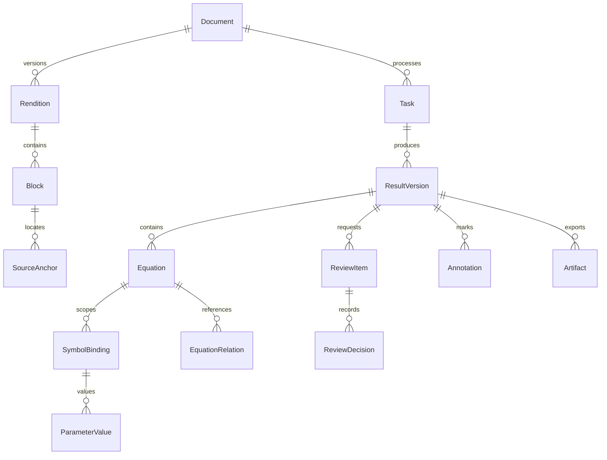

# 架构设计

## 设计决策

采用一个协调 Agent 和固定状态图。解析、数学验证、存储和 PDF 批注由确定性工具执行；模型只负责公式识别与基于检索证据的语义解释。模型输出必须经过结构校验、引用校验和复核策略，不能直接写入最终报告。

首版采用模块化单仓库，API、Worker 和 MCP Server 为独立进程，共享领域契约。无需提前拆分多个微服务或引入向量库。MCP 是能力接口，业务状态始终保存在数据库中。

## 组件与边界

| 组件 | 输入 | 输出 / 责任 |
|---|---|---|
| Web | 文件、复核操作 | 任务进度、报告、PDF 原文对照；不直接持有模型凭据 |
| API | 已认证请求 | 文件归属检查、任务创建、结果查询、复核事务 |
| 调度器 | 已提交的 Outbox 事件 | 向 Celery 投递 task_id，重复投递允许 |
| Worker | task_id | 获取任务租约，启动或恢复状态图 |
| 工作流 | 持久化状态、复核决定 | 节点调度、检查点、可恢复中断 |
| MCP Server | 受控工具参数与可信身份上下文 | 调用领域服务；拒绝任意路径、越权 doc_id |
| 解析适配器 | 规范 PDF | 带来源坐标的 Block、章节与公式候选 |
| 模型适配器 | 区域截图、候选、检索证据 | 受 schema 约束的识别结果与解释候选 |
| 校验器 | 公式、符号、单位和来源 | pass / fail / unknown，以及具体原因 |
| 导出器 | 冻结的 ResultVersion | Markdown、JSON、PDF 与统一 manifest |

Worker 可以和 MCP Server 在本地通过 stdio 连接；生产服务使用受保护的 HTTP，按 SDK 与协议兼容性决定具体传输版本。长任务不能依赖 HTTP 连接存活。

## 文档规范化与位置定位

PDF 是首版唯一的页面坐标基准。DOCX 先在隔离、禁网络、有限 CPU/内存/时间的转换进程生成 PDF，再以该 PDF 做解析和批注。原 DOCX 只读保留，可记录 OOXML 段落/表格标识作为辅助信息，不能将 Word 段落序号冒充稳定页码。

Document 保存原文件哈希、规范 PDF 哈希、转换器版本与页面元数据。所有 Anchor 绑定具体 rendition_id 和 document_version；重新转换产生新版本，旧坐标不能用于新 PDF。

统一锚点采用：page 从 1 开始；bbox 为未旋转页面、左上原点、向右/向下递增的 PDF point（1/72 英寸）；记录 page_width、page_height、rotation、crop 信息。解析器坐标必须先转换到此坐标系。旋转页、裁剪页使用显式变换矩阵，前端再通过 PDF.js viewport 变换映射到显示坐标，不直接按缩放比例猜测。多行定义保存多个 quads，跨页来源拆成多个 Anchor。

报告与批注复用 EQ、SYM、PAR、CHECK 展示编号；数据库使用独立 UUID。编号按首次确认后的阅读顺序分配，修改不重新编号，新增项继续递增。所有引用包含 result_version，避免报告与 PDF 混用版本。

前端的报告链接使用 `/documents/{doc_id}/viewer?version={result_version}&anchor={anchor_id}`。API 校验文档归属后返回规范 PDF 和 Anchor；打开页、框选位置、显示原文摘录。离线 Markdown 使用标准 PDF `#page=N` 链接，并列出编号与坐标；精确框选由在线阅读器提供。

## 数据模型

| 实体 | 关键字段与约束 |
|---|---|
| Document | id、owner_id、original_key、sha256、mime、deleted_at |
| Rendition | document_id、version、pdf_key、sha256、converter_version；不可变 |
| Task | owner_id、document_id、status、current_node、thread_id、lease_until、revision |
| Block | rendition_id、block_id、section_id、kind、text、reading_order |
| SourceAnchor | rendition_id、block_id、page、bbox/quads、quote、quote_hash；页和区域合法 |
| ResultVersion | task_id、version、input_hash、config/model/prompt_versions、status |
| Equation | result_version、display_id、latex、original_number、source_anchor_ids |
| SymbolBinding | equation_id、section_id、name、meaning、definition_anchor_ids、status |
| ParameterValue | binding_id、raw_value、normalized_value、raw_unit、normalized_unit、value_anchor_ids；数值以字符串存储 |
| EquationRelation | from/to_equation_id、relation_type、evidence_anchor_ids；无证据不建立推导关系 |
| ReviewItem / Decision | target、reasons、status；决定保存用户、时间、修改前后值、依据与 revision |
| Artifact / Annotation | version、kind、object_key、sha256；批注关联展示编号与 Anchor |

事实来源分为 `source_explicit`（原文明示）、`derived`（明确写出推导及前提）和 `user_supplied`（用户补充）。用户提供的无原文证据解释必须标明用户补充。未知值用 null，附原因；不把缺失单位写成无量纲。

同名符号按 equation/section 作用域绑定，如不同章节的 k 可以有不同定义。参数值允许多个实验条件或表格行，不能自动覆盖为一个全局值。符号检索保存候选证据，再判断实际定义关系。

## 持久化、一致性与恢复

PostgreSQL 是任务状态与领域结果的权威来源；Redis 不保存唯一副本。API 在一个事务中创建任务和 Outbox，调度器循环投递未确认事件。任务租约与 revision 乐观锁保证同一 task 只有一个有效执行者，过期租约由补偿任务恢复。

LangGraph 使用持久化 Checkpointer，thread_id 固定为 task UUID。节点按 `(task_id, node, input_hash, implementation_version)` 幂等执行；状态中只保存实体 ID、摘要与游标，不塞入完整 PDF、截图或无限增长的对话。

领域写入与 checkpoint 不能假定跨存储原子提交。节点先提交带幂等键的领域输出，再提交 checkpoint；恢复时按幂等键查询已完成输出。重复执行副作用工具也必须返回同一产物记录。

三类导出先写临时对象，计算哈希并验证来源与编号，最终在数据库事务中发布统一 manifest。下载接口只暴露 published 版本；部分失败保留可重试状态，不返回“完成”。用户修订生成新结果版本，原成果保留或按保留策略删除。

## 证据与模型边界

论文内容是待分析数据，里面出现的指令不改变工具权限。模型不能提供本地路径、访问令牌或任意工具名称；工具调用采用允许列表。模型候选必须引用已授权 Block/Anchor，引用不匹配则产生 ReviewItem。

语法可解析不等于公式识别正确；量纲一致不等于推导正确。SymPy 只在受限子进程对允许语法进行处理，不执行用户字符串代码。缺少单位、特殊数学结构或未知假设时返回 unknown，并说明未能完成的校验。

质量策略按识别质量、证据匹配、冲突和校验结果分流，不把模型自报 confidence 当作正确概率。先以人工标注集校准阈值；证据缺失、定义冲突和识别歧义作为硬性复核条件。

## 部署与观测

开发时使用单机容器组成 PostgreSQL、Redis、S3 兼容存储，API/Worker/MCP 分别启动。生产按 API 与 CPU/模型 Worker 分别扩容，LibreOffice 转换在单独受限容器；不需要首版就引入 Kubernetes。

每次调用验证主体与 doc_id 归属；服务间委托身份由服务器签发，不能相信模型参数中的 owner_id。对象存储使用服务器生成的 key、短时授权下载；跨用户去重不得泄露文件存在性。设置文件大小、页数、任务时间、模型用量限额，删除流程涵盖原文、派生文件、结果和 checkpoint。

日志记录 task_id、node、tool、attempt、duration、error_code、model/prompt_version 与费用，不默认记录全文。监控队列延迟、卡住任务、复核率、导出失败率和来源定位错误率。

## 官方参考与兼容性

以下资料于 2026-10-04 核对。设计选择是本项目的工程决策，依赖接口需在实现时实际验证。

- [MCP 2026-07-28 规范](https://modelcontextprotocol.io/specification/2026-07-28)：无状态请求与工具/资源接口。业务任务状态仍需自行持久化；使用该版本前验证 Python SDK 的支持情况。
- [LangGraph persistence](https://docs.langchain.com/oss/python/langgraph/persistence)：checkpointer 支持状态恢复；生产不使用仅内存 checkpoint。
- [Docling 支持格式](https://docling-project.github.io/docling/usage/supported_formats/)：可作为 PDF/DOCX 解析适配器；本项目为坐标一致性选择规范 PDF 路线。
- [PyMuPDF Page API](https://pymupdf.readthedocs.io/en/latest/page.html)：批注由 PDF 页面接口生成；显示效果、旋转页与中文注释需要实测。
