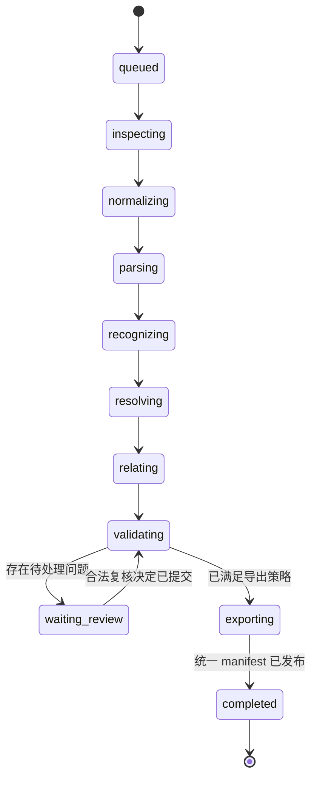

# 主流程与状态设计

## 节点定义

| 节点 | 输入 | 持久化输出 | 失败 / 人工处理 |
|---|---|---|---|
| inspect | Document | mime、页数、加密/扫描标识 | 非法、加密、超限或扫描输入返回明确错误 |
| normalize | 合法文件 | Rendition、转换元数据 | 转换超时有限重试；不继续解析不完整 PDF |
| parse | 规范 PDF | Block、Section、Anchor、候选 | 空结果或无坐标视为解析问题 |
| recognize | 公式候选与截图 | Equation、LaTeX 候选 | 识别歧义进入复核，不丢失区域截图 |
| resolve | Equation 与检索候选 | SymbolBinding、ParameterValue、证据 | 未找到定义保留 null；冲突保存全部候选 |
| relate | Equation 与明确引用 | EquationRelation | 缺少证据不猜推导关系 |
| validate | 当前结果版本 | ValidationFinding、ReviewItem | pass / fail / unknown 分别记录 |
| review_gate | 未处理复核项 | waiting_review checkpoint | 释放 Worker，等待用户操作 |
| export | 冻结结果与批注映射 | 三产物及 manifest | 任一失败只重试相应导出，不重新调用模型 |

任一执行节点都可以进入 failed 或 cancelled。failed 记录最后节点、可重试标识和错误码；重试恢复已完成输出，不从上传重跑。cancelled 是终态，用户明确创建新任务才重新执行；等待复核不占用 Worker。

## 状态数据

状态图保存 task_id、document_id、rendition_id、result_version、current_node、completed_node_keys、review_revision、unresolved_review_ids、attempts、config_version、last_error。外部大对象通过 ID 引用。

API 的 task.status 用于用户查询，checkpoint 用于工作流恢复；Worker 更新状态时使用单调 revision 与租约，API 不绕过工作流任意改 current_node。

## 证据检索次序

按公式所在段落及前后有限窗口检索，扩大到所属章节，再查符号表和全文明确引用。检索支持 Unicode/LaTeX 符号规范化，同时保留原文拼写、下标、大小写与作用域。无法区分的同名定义提交人工选择。

数值与单位首先保留原文字符串，再做可审计规范化；范围、误差、实验条件和表格表头必须绑定对应证据。公式关系首版只建立原文明示的引用边；循环引用允许记录，不作为执行 DAG 强制排序。

## 复核与继续

1. validate 为识别歧义、无来源解释、定义冲突、未知单位等生成稳定 CHECK 编号和 reasons。
2. review_gate 持久化检查点并返回 waiting_review；前端展示公式截图、解释候选与对应证据。
3. 用户可 confirm、edit 或 keep_unknown。确认不能把不存在的证据变成“原文明示”；无来源补充标记 user_supplied。
4. API 通过 expected_revision 校验并发修改，在事务中写入 ReviewDecision、更新 ReviewItem 并创建恢复 Outbox。
5. Worker 使用同一 thread_id 恢复；仅当不存在待处理项时进入重新校验。
6. 修订公式时重跑相关符号/参数及关系校验，修订数值/单位时重跑相关量纲检查；必要时生成新的复核项。
7. keep_unknown 表示用户允许带明确未知标记导出，不代表校验通过。不能通过确认绕过文档归属、损坏坐标或缺失导出文件。

人工拒绝错误识别时使用 edit 将目标标记 excluded，保留原识别与决定审计。复核 UI 可提前展示报告草稿；最终三类成果只在统一版本发布后下载。

## 重试、预算和取消

模型/网络暂时错误采用指数退避和抖动，初始最多 3 次尝试；格式不支持、鉴权失败和确定性解析失败不自动重试。限制文档页数、每节点调用数、总 token/费用与执行时间；具体数值作为部署配置在基准测试后确定。

每个节点与长页循环检查取消标识；外部调用超时后停止后续调用，临时产物由清理任务删除。租约失效的旧 Worker 即使完成也不能发布结果。耗尽重试后标记 failed，保留来源及错误以便恢复。

## 批注约定

| 编号 | 样式 | 位置与内容 |
|---|---|---|
| EQ-01 | 蓝色框 | 公式区域、原公式编号、LaTeX 摘要 |
| SYM-01 | 橙色下划线 | 原文定义的文字 quads |
| PAR-01 | 绿色高亮 | 数值与单位的原文 quads |
| CHECK-01 | 虚线框与注释 | 待核对区域、具体原因及当前处理状态 |

未知项缺少可定位证据时在公式区域附 CHECK 注释，说明未找到定义；不能虚构定义所在坐标。批注不改变原文内容；颜色必须配合编号与文字说明。
